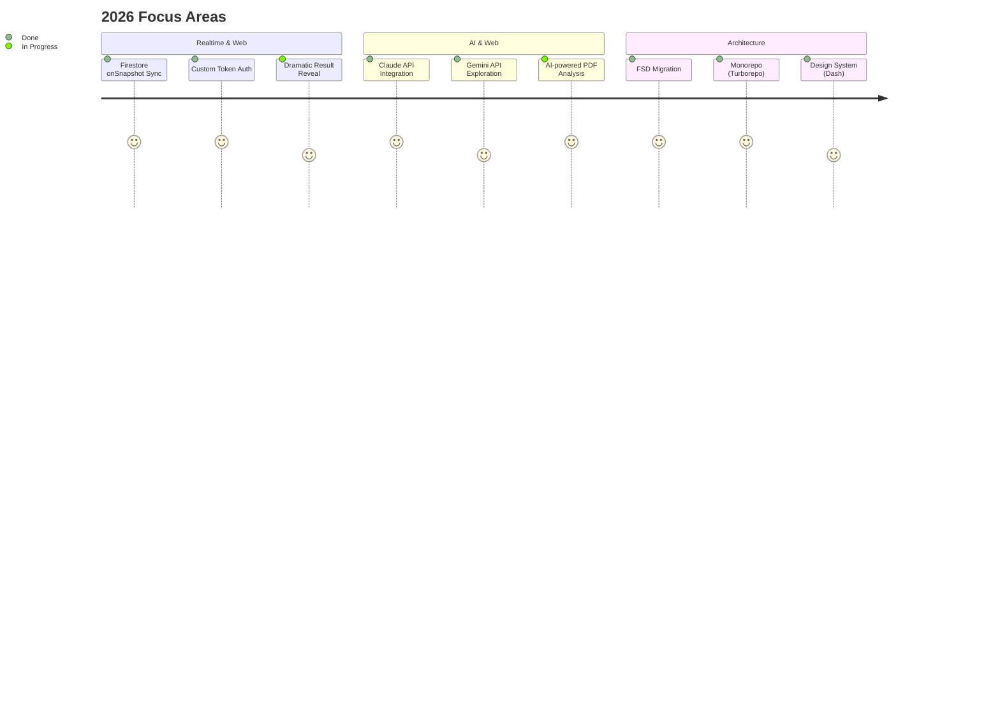

<div align="center">

[](https://github.com/sgd122)

# Gidong Seong

**Web Developer** &nbsp;&middot;&nbsp; Seoul, Korea

I build web products with clean architecture and great developer experience.<br/>
Currently at **[@NCredibleAI](https://github.com/NCredibleAI)**, building AI Agent × OT products for food manufacturing.<br/>
Previously at **[@travelmakers](https://github.com/travelmakers)**, building Next.js platforms and design systems.

<br/>

[`Blog`](https://blog.dnd.ac/) &nbsp;&middot;&nbsp; [`LinkedIn`](https://www.linkedin.com/in/sgd122/) &nbsp;&middot;&nbsp; [`Email`](mailto:sgd0947@gmail.com)

</div>

<br/>

## Currently Working On

- Building [**GDG Busan Hackathon Vote**](https://github.com/gdg-busan/2026-Build-with-AI-Hackaton-in-Busan) — 실시간 투표 플랫폼 (Next.js 16 + React 19 + Cloud Firestore)
- Designing weighted scoring (심사위원 + 참가자 가중 점수) with anti-fraud 4중 검증
- Crafting a "Living Terminal" dark UI with dramatic countdown result reveals



<br/>

## Dev Approach

```
Type-safe everything     Zod validation + TypeScript strict mode, end-to-end type safety
FSD architecture         Layered imports: shared → entities → features → widgets → pages
Monorepo-first           Turborepo + pnpm workspaces, shared packages across apps
Production habits        Rate limiting, audit logging, PII filtering, CORS — built in from day one
```

<br/>

## Stack

```
Frontend        TypeScript  ·  React  ·  Next.js  ·  Tailwind CSS  ·  React Native
Backend         Node.js  ·  Supabase  ·  Firebase  ·  GraphQL  ·  MySQL
Infra           Docker  ·  GitHub Actions  ·  AWS  ·  Vercel  ·  Turborepo
```

<br/>

<details>
<summary><b>WakaTime</b></summary>
<br/>

<!--START_SECTION:waka-->


**I'm an Early 🐤** 

```text
🌞 Morning                6407 commits        ██████░░░░░░░░░░░░░░░░░░░   25.32 % 
🌆 Daytime                13349 commits       █████████████░░░░░░░░░░░░   52.75 % 
🌃 Evening                5401 commits        █████░░░░░░░░░░░░░░░░░░░░   21.34 % 
🌙 Night                  148 commits         ░░░░░░░░░░░░░░░░░░░░░░░░░   00.58 % 
```
📅 **I'm Most Productive on Wednesday** 

```text
Monday                   3785 commits        ████░░░░░░░░░░░░░░░░░░░░░   14.96 % 
Tuesday                  4941 commits        █████░░░░░░░░░░░░░░░░░░░░   19.53 % 
Wednesday                5972 commits        ██████░░░░░░░░░░░░░░░░░░░   23.60 % 
Thursday                 4091 commits        ████░░░░░░░░░░░░░░░░░░░░░   16.17 % 
Friday                   3438 commits        ███░░░░░░░░░░░░░░░░░░░░░░   13.59 % 
Saturday                 1548 commits        ██░░░░░░░░░░░░░░░░░░░░░░░   06.12 % 
Sunday                   1530 commits        ██░░░░░░░░░░░░░░░░░░░░░░░   06.05 % 
```


📊 **This Week I Spent My Time On** 

```text
🕑︎ Time Zone: Asia/Seoul

💬 Programming Languages: 
Other                    6 hrs 10 mins       █████████████████████████   100.00 % 

🔥 Editors: 
Google Calendar          4 hrs 1 min         ████████████████░░░░░░░░░   65.18 % 
Cursor                   1 hr 54 mins        ████████░░░░░░░░░░░░░░░░░   30.86 % 
Antigravity CLI          12 mins             █░░░░░░░░░░░░░░░░░░░░░░░░   03.27 % 
Antigravity Desktop      2 mins              ░░░░░░░░░░░░░░░░░░░░░░░░░   00.69 % 

💻 Operating System: 
Unknown OS               4 hrs 1 min         ████████████████░░░░░░░░░   65.18 % 
Mac                      2 hrs 8 mins        █████████░░░░░░░░░░░░░░░░   34.82 % 
```

🤖 **AI Coding This Week** 

```text
⏱ AI Coding Time: 2 hrs 8 mins (34.82%)

✍️ 0 lines written by AI, 0 lines written by hand (0% AI-written)

🔤 73,805 Input Tokens, 313 Output Tokens

💵 $0.81 Estimated AI Cost This Week

🧠 16 AI Sessions, 36 AI Prompts

GPT                      0 lines             ░░░░░░░░░░░░░░░░░░░░░░░░░   00.00 % 

🔎 AI Coding Insights:
🧑‍💻 Mostly Hands-On — 0% of written lines came from AI
📝 Concise Prompter — average 126 characters per prompt
🔁 Iterative Prompter — average 2 prompts per session
🚀 High AI Trust — 0% of changed lines were hand-edited
```

**I Mostly Code in TypeScript** 

```text
TypeScript               36 repos            ████████████░░░░░░░░░░░░░   46.15 % 
JavaScript               22 repos            ███████░░░░░░░░░░░░░░░░░░   28.21 % 
Jupyter Notebook         2 repos             █░░░░░░░░░░░░░░░░░░░░░░░░   02.56 % 
Shell                    1 repo              ░░░░░░░░░░░░░░░░░░░░░░░░░   01.28 % 
MDX                      1 repo              ░░░░░░░░░░░░░░░░░░░░░░░░░   01.28 % 
```


 Last Updated on 25/10/2026 03:51:43 UTC
<!--END_SECTION:waka-->

</details>

<br/>

<div align="center">

[](https://github.com/sgd122)

</div>
