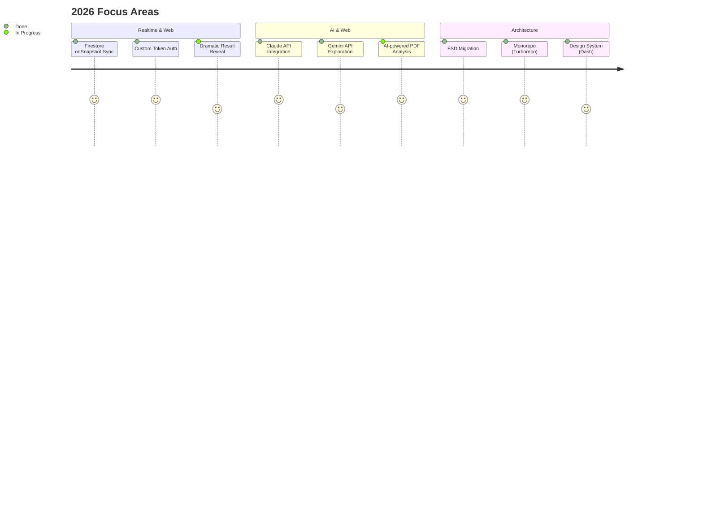

<div align="center">

[](https://github.com/sgd122)

# Gidong Seong

**Web Developer** &nbsp;&middot;&nbsp; Seoul, Korea

I build web products with clean architecture and great developer experience.<br/>
Currently at **[@NCredibleAI](https://github.com/NCredibleAI)**, building AI Agent × OT products for food manufacturing.<br/>
Previously at **[@travelmakers](https://github.com/travelmakers)**, building Next.js platforms and design systems.

<br/>

[`Blog`](https://blog.dnd.ac/) &nbsp;&middot;&nbsp; [`LinkedIn`](https://www.linkedin.com/in/sgd122/) &nbsp;&middot;&nbsp; [`Email`](mailto:sgd0947@gmail.com)

</div>

<br/>

## Currently Working On

- Building [**GDG Busan Hackathon Vote**](https://github.com/gdg-busan/2026-Build-with-AI-Hackaton-in-Busan) — 실시간 투표 플랫폼 (Next.js 16 + React 19 + Cloud Firestore)
- Designing weighted scoring (심사위원 + 참가자 가중 점수) with anti-fraud 4중 검증
- Crafting a "Living Terminal" dark UI with dramatic countdown result reveals



<br/>

## Dev Approach

```
Type-safe everything     Zod validation + TypeScript strict mode, end-to-end type safety
FSD architecture         Layered imports: shared → entities → features → widgets → pages
Monorepo-first           Turborepo + pnpm workspaces, shared packages across apps
Production habits        Rate limiting, audit logging, PII filtering, CORS — built in from day one
```

<br/>

## Stack

```
Frontend        TypeScript  ·  React  ·  Next.js  ·  Tailwind CSS  ·  React Native
Backend         Node.js  ·  Supabase  ·  Firebase  ·  GraphQL  ·  MySQL
Infra           Docker  ·  GitHub Actions  ·  AWS  ·  Vercel  ·  Turborepo
```

<br/>

<details>
<summary><b>WakaTime</b></summary>
<br/>

<!--START_SECTION:waka-->


**I'm an Early 🐤** 

```text
🌞 Morning                6471 commits        ██████░░░░░░░░░░░░░░░░░░░   25.42 % 
🌆 Daytime                13402 commits       █████████████░░░░░░░░░░░░   52.66 % 
🌃 Evening                5431 commits        █████░░░░░░░░░░░░░░░░░░░░   21.34 % 
🌙 Night                  148 commits         ░░░░░░░░░░░░░░░░░░░░░░░░░   00.58 % 
```
📅 **I'm Most Productive on Wednesday** 

```text
Monday                   3830 commits        ████░░░░░░░░░░░░░░░░░░░░░   15.05 % 
Tuesday                  4981 commits        █████░░░░░░░░░░░░░░░░░░░░   19.57 % 
Wednesday                5974 commits        ██████░░░░░░░░░░░░░░░░░░░   23.47 % 
Thursday                 4131 commits        ████░░░░░░░░░░░░░░░░░░░░░   16.23 % 
Friday                   3458 commits        ███░░░░░░░░░░░░░░░░░░░░░░   13.59 % 
Saturday                 1548 commits        ██░░░░░░░░░░░░░░░░░░░░░░░   06.08 % 
Sunday                   1530 commits        ██░░░░░░░░░░░░░░░░░░░░░░░   06.01 % 
```


📊 **This Week I Spent My Time On** 

```text
🕑︎ Time Zone: Asia/Seoul

💬 Programming Languages: 
Other                    3 hrs               █████████████████████████   100.00 % 

🔥 Editors: 
Google Calendar          3 hrs               █████████████████████████   100.00 % 

💻 Operating System: 
Unknown OS               3 hrs               █████████████████████████   100.00 % 
```

🤖 **AI Coding This Week** 

```text
No AI Coding Activity Tracked This Week
```

**I Mostly Code in TypeScript** 

```text
TypeScript               36 repos            ████████████░░░░░░░░░░░░░   46.15 % 
JavaScript               22 repos            ███████░░░░░░░░░░░░░░░░░░   28.21 % 
Jupyter Notebook         2 repos             █░░░░░░░░░░░░░░░░░░░░░░░░   02.56 % 
Shell                    1 repo              ░░░░░░░░░░░░░░░░░░░░░░░░░   01.28 % 
MDX                      1 repo              ░░░░░░░░░░░░░░░░░░░░░░░░░   01.28 % 
```


 Last Updated on 26/10/2026 03:54:05 UTC
<!--END_SECTION:waka-->

</details>

<br/>

<div align="center">

[](https://github.com/sgd122)

</div>
